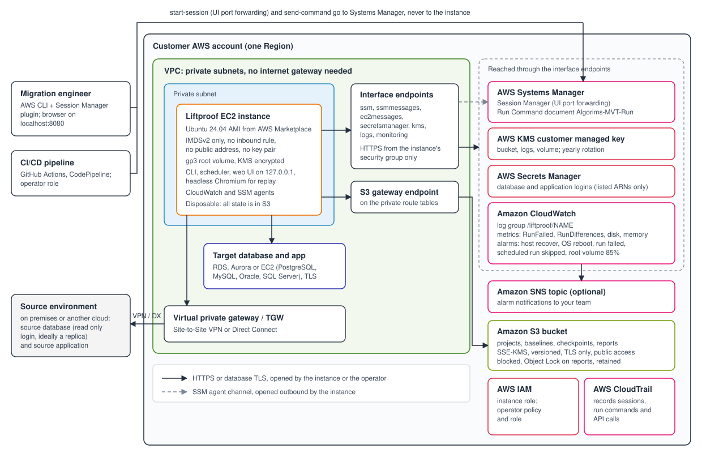

# Liftproof deployment guide

This guide takes an AWS administrator from subscribing to Liftproof on AWS Marketplace to
a first report, and then through running, monitoring, recovering, upgrading and removing
it. It is the guide the AWS Foundational Technical Review and the 30 minute
"launch to first journey" target (docs/kpis.md) are measured against.

Liftproof proves that an application moved to AWS behaves as it did before: it reconciles
the source and target databases, compares files, and replays recorded web journeys
against the new environment. Each run ends in an HTML and JSON report kept in your own S3
bucket. Everything runs in your account; nothing calls home.

## 1. Architecture



([architecture.png](architecture.png) is the same diagram as an image for the AWS
Marketplace listing.)

One deployment is one EC2 instance in a private subnet of your VPC, with:

- **No inbound path.** No inbound security group rule, no public address, no key pair.
  People reach the web UI through Session Manager port forwarding; pipelines start runs
  through Systems Manager Run Command.
- **Scoped egress.** HTTPS to the VPC's interface endpoints and the S3 gateway endpoint,
  and only the database and application addresses and ports you declare.
- **One S3 bucket** holding projects, baselines, checkpoints and reports: versioned,
  encrypted with your KMS key, public access blocked, TLS only, reports under Object Lock.
- **One customer managed KMS key** (rotation on) for the bucket, the log group and the
  instance volume, or your own key.
- **Secrets Manager** for every database and application credential. The instance reads
  only the secrets you list.
- **CloudWatch** for the product log, instance health metrics and alarms.

The instance is disposable: nothing on it is the only copy of anything. That shapes the
reliability design (section 9).

## 2. Prerequisites

| You need | Notes |
|---|---|
| An AWS account and Region | Any commercial Region where the listing is available. Deploy where the target environment is. |
| A VPC with a private subnet | The subnet must reach your source and target databases and applications. For an on premises source that means Site-to-Site VPN or Direct Connect. `infra/modules/network` is a reference VPC if you have none. |
| VPC endpoints, or let the template create them | Interface endpoints for `ssm`, `ssmmessages`, `ec2messages`, `secretsmanager`, `kms`, `logs` and `monitoring`, and an S3 gateway endpoint on the private route tables. Reusing existing endpoints saves about $100 a month (section 4). |
| Permission to deploy | An IAM principal that can create EC2, IAM roles and instance profiles, S3, KMS, CloudWatch, Systems Manager documents and VPC endpoints. Deploying needs administrator-level permission once; running Liftproof afterwards does not. |
| Database logins | A **read only** login on the source (SELECT on the schemas you compare), and a login on the target. See section 6. |
| AWS CLI v2 and the Session Manager plugin | On the engineer's machine, to open the UI and start runs. |
| Skills | Working knowledge of VPC networking, IAM and Secrets Manager. No Linux administration is needed. |

Liftproof supports PostgreSQL 13 and later, MySQL 8.0 and later (including Aurora MySQL
3), Oracle 19c and later, and SQL Server 2016 and later, on premises or on Amazon RDS and
Aurora. Older engines are refused when Liftproof connects.

## 3. Choosing an instance size

The instance does the hashing the databases do not do themselves, runs the browser for
replay, and holds working copies. Measured throughput is about 1.2 million rows a minute
per table on 2 to 4 vCPUs with the source read at its default cap (docs/kpis.md).

| Workload | Instance type | Root volume |
|---|---|---|
| Up to about 50 tables and 100 million rows, up to 100 journeys | m7i.xlarge (4 vCPU, 16 GiB), the default | 100 GiB |
| Several hundred tables or up to 1 billion rows; parallel workers or journeys | m7i.2xlarge (8 vCPU, 32 GiB) | 200 GiB |
| Very large tables with JSON, XML or non-ASCII text hashed on the instance, or many parallel journeys | m7i.4xlarge, or r7i for memory | 300 GiB or more |
| A small proof of concept | m7i.large | 50 GiB |

Throughput usually depends more on the source than on the instance: the source is capped
at 125,000 rows a second per connection by default to protect production (README,
Protecting the source). A read replica with no cap is the fastest source. The root volume
alarm (section 8) tells you when to grow the volume, which you can do without replacing
the instance.

## 4. Costs

You pay the Liftproof software charge on AWS Marketplace and the AWS resources it runs on.
Approximate on-demand prices for the AWS resources, per deployment per month:

| Item | Approx. per month |
|---|---|
| m7i.xlarge, always on | ~$150 |
| 7 interface endpoints in 2 Availability Zones | ~$100 plus data processing |
| KMS key, Secrets Manager (2 to 4 secrets), CloudWatch Logs and metrics, S3 | ~$10 to $30 |
| Site-to-Site VPN, if used | ~$36 plus data transfer |

To keep costs down:

- **Reuse existing VPC endpoints** (`create_vpc_endpoints = false`, CloudFormation
  `CreateVpcEndpoints = false`). In a VPC that already has them, the endpoints are the
  largest saving.
- **Stop the instance between migration windows.** Nothing is lost: all state is in S3.
  Scheduled runs missed while it is stopped do not pile up; the latest one runs once when
  it starts again. The alarms ignore a stopped instance.
- Expire captured request and response bodies sooner (`asset_retention_days`,
  `AssetRetentionDays`) and old object versions (`noncurrent_version_days`,
  `NoncurrentVersionDays`).

Use the AWS Pricing Calculator for your Region.

## 5. What gets created

| Resource | Purpose |
|---|---|
| EC2 instance, security group, launch template (CloudFormation) | The product. IMDSv2 only, encrypted gp3 root volume, detailed monitoring |
| IAM role and instance profile `liftproof-NAME-instance` | Read and write the deployment's bucket, use its key, read the listed secrets, write its log group and metrics in the `Liftproof` namespace, and the Systems Manager agent |
| IAM policy `liftproof-NAME-operator` (and a role, when you name principals) | For people and pipelines: open the UI, run the Run Command document, read reports |
| S3 bucket | Projects, baselines, checkpoints, reports. Kept when the deployment is deleted |
| KMS key and alias (unless you bring one) | Encrypts the bucket, log group and volume. Kept when the deployment is deleted |
| CloudWatch log group `/liftproof/NAME` | The product log. Kept when the deployment is deleted |
| Systems Manager document `Algorims-MVT-Run-NAME` | Starts runs, doctor and UI logins |
| CloudWatch alarms | Section 8 |
| VPC endpoints and their security group (optional) | Private access to AWS services |

No IAM users or access keys are created, and nothing outside your account is granted
access.

## 6. Credentials and security

**Database and application credentials never leave Secrets Manager.** Project files hold
only secret ARNs, so a project file can be handed to a colleague or kept in Git.

1. Create one secret per database login, in the deployment's Region, as key/value with
   the keys `username` and `password`. Use a customer managed KMS key if your policy
   requires one, and list it as a secret key (`secret_kms_key_arns`, `SecretKmsKeyArns`).
2. Give the secret ARNs to the deployment (`secret_arns`, `SecretArns`). The instance role
   can read those secrets and no others.
3. Reference each secret from the project file (`secret_arn:`).

What each login needs:

- **Source:** read only. SELECT on the schemas compared, nothing else. `liftproof doctor`
  fails if the source login can write. On Oracle, SELECT on `V$DATABASE` lets the report
  record the exact SCN. Replication checks need read access to the replication views they
  name (docs/decisions.md, 58 and 62 to 63).
- **Target:** read access to the compared schemas. Replay windows (`database.replay_watermarks`)
  read the tables journeys write to.
- **Web journeys:** logins used during replay are bound to secrets with `liftproof bind`;
  recordings keep a token, never the value.
- **S3 file sources outside the account:** an access key pair in a secret
  (`access_key_id`, `secret_access_key`).

**Rotation.** Secrets Manager rotation is supported: Liftproof reads a secret each time a
run connects, so the next run uses the new value. The KMS key rotates yearly
automatically.

**Data handling.** Database rows are compared as hashes. Row values appear in a report
only when you ask for them (`--show-values`), and are redacted in support bundles.
Captured web responses may hold production data: they are tagged and expire after
`asset_retention_days` (`AssetRetentionDays`, 90 by default). Logs never contain SQL parameter values or secret
values; core dumps are disabled.

**Database connections** use TLS with full certificate verification by default. The image
trusts the public certificate authorities and the Amazon RDS CAs; for a private CA, point
`sslrootcert` at your bundle. A lower setting is reported in every report.

**Access to the instance** is only through Session Manager, controlled by IAM and logged
by CloudTrail. To keep Session Manager transcripts, turn on session logging in your
account's Session Manager preferences.

## 7. Deploy

### With CloudFormation (AWS Marketplace)

1. Store the credentials (section 6).
2. In AWS Marketplace, subscribe to Liftproof and choose **Launch CloudFormation**.
3. Fill in the parameters. The required ones are the deployment name, VPC, private subnet,
   the database slots (CIDR and port for each database) and the secret ARNs. Leave
   **ImageId** at its default. Give an SNS topic in **AlarmTopicArn** to be notified of
   alarms.
4. Create the stack (about 10 minutes, most of it the VPC endpoints).

### With Terraform

```bash
cd infra/envs/customer-example        # or call infra/modules/liftproof from your own root
terraform init
terraform apply -var ami_id=ami-... -var source_database_cidr=10.1.2.0/24 \
  -var target_database_cidr=10.42.0.0/20 -var 'application_cidrs=["10.1.3.0/24"]'
```

Keep the state in a remote S3 backend (the backend block in the example is ready to
uncomment). With your own KMS key, add the key policy statements in infra/README.md
("Bring your own KMS key") first.

## 8. Check it works, and monitor it

**Health check.** Run doctor through the run document (the **RunDocument** /
`run_document_name` output) with mode `doctor`, or in a Session Manager shell:

```bash
sudo -u mvt liftproof doctor --project /var/lib/mvt/projects/acme.yaml
```

It checks every AWS service endpoint, the bucket (a write and read back), the secrets,
TLS, the database connections and that the source login is read only. Every failure comes
with a fix.

**First report.** Run the worked example (project `example`, mode `files`). It finds one
changed invoice amount and writes its report to the bucket. Then open the UI (the
**ConnectUi** output, docs/ui.md) and create your own project with `liftproof init`.

**Alarms.** Every alarm notifies the SNS topic you give (`alarm_topic_arn`,
`AlarmTopicArn`).

| Alarm | Fires when | What happens or what to do |
|---|---|---|
| `liftproof-NAME-system-status` | The AWS host fails | EC2 recovers the instance onto new hardware automatically |
| `liftproof-NAME-instance-status` | The operating system stops answering for 3 minutes | EC2 reboots the instance. Resume an interrupted reconciliation with `--resume` |
| `liftproof-NAME-run-failed` | A run ended without a verdict (exit code 2 or 3) | Read the run's report or the log; `liftproof doctor`; `liftproof support-bundle` for a ticket |
| `liftproof-NAME-scheduled-run-skipped` | A scheduled run found the previous one still running | Spread the schedules or size up; nightly validation may have stopped |
| `liftproof-NAME-root-volume` | The root volume is over 85% full | Grow the volume (EC2 console, no restart), or clear old working directories |

Metrics, all in the `Liftproof` namespace with the `Deployment` dimension: `RunFailed`,
`RunDifferences`, `ScheduledRunSkipped`, `disk_used_percent`, `mem_used_percent`. Once the
target has taken over and nightly runs should be clean, add an alarm on
`RunDifferences` (docs/pipelines.md).

**Logs.** The product log is `/var/log/mvt/liftproof.log` on the instance and the
`/liftproof/NAME` log group in CloudWatch. `--log-level debug` adds the SQL text (never
values).

## 9. Backup and recovery

**Where everything is.** Projects, recordings, baselines, checkpoints and reports are in
the S3 bucket as they are written. The instance holds only working copies.

| What | Protection |
|---|---|
| Reports | Written once at the end of each run; Object Lock (governance) for `report_lock_days` (`ReportLockDays`, 365 by default); versioned |
| Baselines, recordings, projects | Versioned; old versions kept for `noncurrent_version_days` (`NoncurrentVersionDays`) |
| A reconciliation or baseline under way | Findings sent at least every minute; progress checkpointed after each table |
| A replay under way | Each journey's findings written as it finishes |

**Recovery objectives.**

| Failure | Recovery | RPO (data lost) | RTO (back in service) |
|---|---|---|---|
| AWS host failure | Automatic (EC2 recovery) | Work since the last checkpoint of a run under way | Minutes |
| Operating system hang | Automatic (reboot) | As above | Minutes |
| Instance terminated or root volume broken | Raise the instance generation (below) | As above | About 10 minutes |
| Report or baseline deleted or overwritten | Restore the previous object version; locked reports cannot be deleted | None | Minutes |
| Availability Zone outage | Redeploy in a subnet of another AZ (below) | None for stored data | About 15 minutes |
| Region outage | Deploy in another Region; with S3 replication configured, the reports are there | Up to your replication lag | Under an hour |

A resumed reconciliation compares only the tables it had not finished. A replay is never
resumed, because its journeys created data on the target: its finished journeys keep
their findings and the rest are listed as not run, so run it again. These figures are
targets to be confirmed by the first test launch.

**Replacing the instance.** Raise the instance generation by one:
`instance_generation = 2` in Terraform, or update the stack with **InstanceGeneration**
2. The new instance gets the same bucket, key, settings and alarms, brings the projects
back from the bucket at first boot, and lists every earlier run. Then resume any
interrupted run:

```bash
sudo -u mvt liftproof reconcile --project /var/lib/mvt/projects/acme.yaml --resume
```

A lost instance's run lock expires 15 minutes after it was last renewed; a resume before
then is refused with exit code 2. **Moving to another Availability Zone** is the same
update with a subnet in that zone.

**Single instance by design.** Liftproof runs validations in batches; it does not serve
traffic. A second, standby instance would double the cost and add nothing a replacement
from the bucket does not already give.

**Cross-Region copies.** For reports that must survive a Region outage, add S3
replication from the bucket to a bucket in another Region (with a KMS key there).

## 10. Routine maintenance

**Upgrading to a new version.** New versions bring fixes and operating system patches;
the instance does not patch itself (SECURITY.md: at least monthly, and within 7 days of a
fix for a critical vulnerability). Check that no run is under way (`liftproof runs`),
then:

- CloudFormation: update the stack, keeping the parameters. **ImageId** resolves to the
  latest version on every stack update, so the instance is replaced with it. Any stack
  update moves to the latest version, so make updates outside run windows.
- Terraform: set `ami_id` to the new version's AMI and raise `instance_generation` by
  one. Changing `ami_id` alone does nothing, so an upgrade is always deliberate.

Projects, baselines and reports carry over through the bucket. `liftproof version`
shows the running version; the login message shows when the image was built.

**Other routine tasks.**

| Task | How often | How |
|---|---|---|
| Check the alarms are going to someone | When people change | The SNS topic's subscriptions |
| Rotate database passwords | Your policy | Secrets Manager rotation; no change in Liftproof |
| KMS key rotation | Yearly | Automatic |
| Grow the root volume | When the root volume alarm fires | Modify the EBS volume; the file system grows on the next reboot |
| Review IAM principals allowed the operator role | Quarterly | `operator_principal_arns` / `OperatorPrincipalArns` |
| Remove old projects' data | After a migration | Delete the project's prefix in the bucket (locked reports stay until their lock ends) |

## 11. Troubleshooting and support

1. `liftproof doctor` names most problems (network path, permission, secret, TLS) with a
   fix.
2. The exit code says what kind of failure it was: 0 passed, 10 differences found, 2 the
   run failed (no verdict), 3 configuration error (README, Exit codes).
3. `liftproof support-bundle --project acme.yaml --doctor` writes one file for a support
   ticket, with every data value removed.

Support: SUPPORT-CONTACT-TO-BE-CONFIRMED (email, hours and response times as in the
listing's support terms). Security issues: security@algorims.com (SECURITY.md).

## 12. Removing a deployment

Delete the stack, or `terraform destroy`. The instance, roles, endpoints, alarms and
document are removed. **The bucket, KMS key and log group are kept**, because the reports
are go-live sign-off records. To remove them too, wait until the reports' Object Lock
retention has ended (or have a principal with `s3:BypassGovernanceRetention` remove
them), empty the bucket, delete it, delete the log group, and schedule the key for
deletion.
