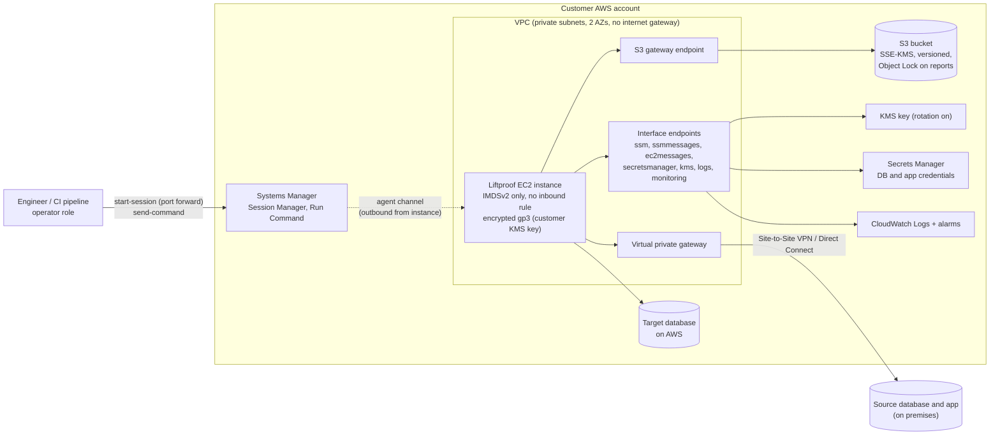

# Liftproof infrastructure

Everything here is Terraform (plus a Packer template for the AMI). It passes
`terraform validate` and a Checkov scan with no open findings; every Checkov skip is
written next to the resource with its reason. Nothing has been applied to any account.

```
infra/
  modules/liftproof            what a customer deploys: the product and everything around it
  modules/network           reference private VPC (for customers without one, and for tests)
  modules/account-baseline  security baseline for Algorims' own AWS accounts
  modules/build-account     GitHub OIDC release role, AMI builder, evidence store, Marketplace ingestion
  envs/customer-example     example customer root: network + liftproof
  envs/algorims-build       Algorims build account root: baseline + network + build
  packer/                   the product AMI (Amazon Linux 2023, IMDSv2, no SSH, hardened)
  scripts/scan-ami.sh       Amazon Inspector release gate for the AMI's OS layer
```

## Customer deployment



The operator arrow goes to Systems Manager, never to the instance: there is no inbound
path to the host at all.

| Area | What the module does | Requirement |
|---|---|---|
| Identity | Instance role with least privilege; separate operator policy/role; no IAM users, no access keys | IAM-002, N1 |
| Metadata | IMDSv2 required, hop limit 1 | AWSAPI-004, N2 |
| Access | No inbound security group rules, no public IP, no SSH in the image; Session Manager port forwarding for the UI | spec 3 |
| Pipelines | SSM Command document with validated parameters; the run executes in its own systemd unit and returns the product's exit code | ATS-005, F11 |
| Encryption | One customer managed KMS key (rotation on) for S3, logs and the root volume; bucket denies non-TLS, TLS < 1.2 and any other key | SECOPS-004, N7 |
| Storage | Versioning, block public access, bucket-owner-enforced, Object Lock (governance) on reports, lifecycle expiry for recorded bodies and snapshots, noncurrent version expiry, multipart cleanup | F15 |
| Network | Private subnets, VPC endpoints, egress limited to endpoints, S3 prefix list and the declared databases and applications, VPC Flow Logs, default security group locked | spec 3 |
| Resilience | EC2 auto recovery, status check alarm with the recover action, nothing irreplaceable on the instance | PS-001 |
| Operations | Encrypted log group with retention; alarm when a scheduled run is skipped | spec 14, 16 |

### Deploy (customer)

```bash
cd infra/envs/customer-example
terraform init
terraform apply -var ami_id=ami-... -var source_database_cidr=10.1.2.0/24 \
  -var target_database_cidr=10.42.0.0/20 -var 'application_cidrs=["10.1.3.0/24"]'
```

Then store the database logins in Secrets Manager under `liftproof/acme-prod/`
(`{"username": ..., "password": ...}`), open the UI with the `connect_ui` output, and
run `liftproof doctor`.

## Algorims build account

- **Account baseline:** CloudTrail (all regions, log file validation, KMS, CloudWatch
  Logs), GuardDuty, Amazon Inspector (EC2, ECR), Security Hub with AWS Foundational
  Security Best Practices, IAM Access Analyzer, account-wide S3 Block Public Access,
  EBS encryption by default, IMDSv2 by default, a strict password policy, S3 access
  logging and a monthly budget alert.
- **Release path:** GitHub Actions assumes `liftproof-github-release` through OIDC, only
  from `main` and `v*` tags. No stored keys (the second half of IAM-002).
- **AMI:** Packer builds over Session Manager in a private subnet. Amazon Inspector then
  scans an instance of the new AMI, and any HIGH or CRITICAL finding fails the release
  (ATS-009). Build logs, the dependency audit and scan findings go to an evidence bucket
  under Object Lock compliance mode for 400 days.
- **Marketplace:** an ingestion role lets AWS Marketplace scan and copy each AMI version.

The image itself is unencrypted because AWS Marketplace does not accept AMIs with
encrypted snapshots. Customer volumes are encrypted with the customer's key at launch.

## Rough running cost (customer, per deployment)

These are estimates from on-demand list prices. Confirm them in the AWS Pricing
Calculator for your region.

| Item | Approx. per month |
|---|---|
| m7i.xlarge, always on | ~$150 |
| 7 interface endpoints × 2 AZs | ~$100 plus data processing |
| KMS key, Secrets Manager (2 to 4 secrets), CloudWatch Logs, S3 | ~$10 to $30 |
| Site-to-Site VPN, if used | ~$36 plus data transfer |

Stopping the instance between migration windows removes most of the compute cost. The
endpoints can be shared with other workloads in the same VPC by setting
`create_vpc_endpoints = false`.

## What is still to do

- A CloudFormation version of `modules/liftproof` for the Marketplace listing's
  "launch with CloudFormation" option (spec 3 promises both).
- Chromium and its libraries in the AMI once the recorder lands (the base image
  decision, Amazon Linux 2023 or Ubuntu, is still open).
- Remote state bucket for the Terraform roots (backend blocks are in place, commented).
